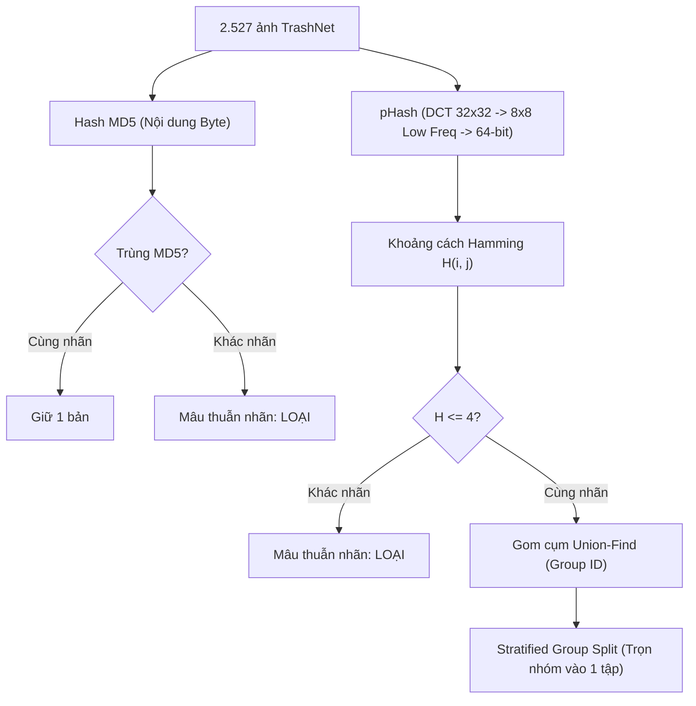
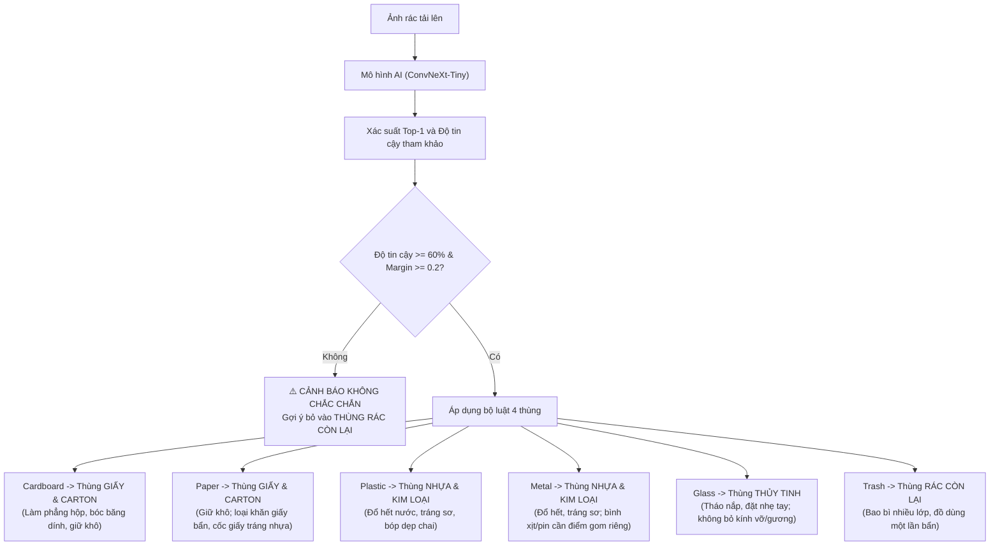

# BÁO CÁO KHOA HỌC & THỰC THI NGUYÊN MẪU AI02: TRƯỜNG HỌC XANH
## AI NHẬN DIỆN VÀ PHÂN LOẠI RÁC THẢI THÔNG MINH

> **Tóm tắt dự án**: Dự án thiết kế nguyên mẫu AI hỗ trợ sinh viên phân loại rác trong khuôn viên trường học bằng một hình ảnh đầu vào. Toàn bộ quy trình được thực hiện nghiêm ngặt qua 5 bước: Khảo sát & lọc trùng/lỗi trên bộ dữ liệu **TrashNet (2.527 ảnh)**, xây dựng **Baseline BTC**, nghiên cứu hai hướng cải tiến (**Đặc trưng thủ công nâng cao** và **Mạng nơ-ron học sâu ConvNeXt-Tiny**), đánh giá độ ổn định (Robustness) trên 10 kịch bản biến thể thực tế và xây dựng hệ thống demo phân loại 4 thùng rác kèm phân tích trực quan Grad-CAM.

---

## 1. Bối cảnh, Dữ liệu và Phương pháp luận

### 1.1. Bối cảnh bài toán
Trong môi trường trường học xanh, sinh viên thường gặp khó khăn khi phân loại nhanh rác thải vào đúng thùng (đặc biệt là các loại rác bao bì nhiều lớp, chai nhựa trong suốt dễ lẫn với thủy tinh, bìa carton mỏng dễ nhầm với giấy in). Mục tiêu là xây dựng nguyên mẫu AI nhận diện từ ảnh đơn và đưa ra **gợi ý hành động thực tế** (xử lý sơ bộ trước khi bỏ vào thùng rác).

### 1.2. Giả định hệ thống phân loại tại khuôn viên trường
> [!IMPORTANT]
> **Quy ước giả định theo đề bài**: Tên vật liệu **không đồng nghĩa** với khả năng tái chế ở mọi địa phương. Khuôn viên trường được thiết lập hệ thống **4 thùng rác tiêu chuẩn**:
> 1. **Thùng Giấy & Carton** (Vàng): Giấy in, vở, sách báo, hộp carton đã làm sạch dầu mỡ.
> 2. **Thùng Nhựa & Kim loại** (Xanh lam): Chai nhựa PET/HDPE, lon nhôm, hộp thiếc đã tráng sạch.
> 3. **Thùng Thủy tinh** (Xanh ngọc): Chai lọ thủy tinh nguyên vẹn (không bao gồm kính xây dựng, gương vỡ, sứ).
> 4. **Thùng Rác còn lại** (Xám): Rác hữu cơ thừa, giấy ăn bẩn, bao bì màng nhôm ghép, rác khó xác định.

---

## 2. Bước 1: Khảo sát Phân phối 6 Lớp và Kiểm tra Dữ liệu Lỗi / Trùng lặp

### 2.1. Phân phối số lượng và độ mất cân bằng
Quét toàn bộ 2.527 ảnh trong 6 thư mục lớp của TrashNet:
- `paper`: 594 ảnh (23.5%)
- `glass`: 501 ảnh (19.8%)
- `plastic`: 482 ảnh (19.1%)
- `metal`: 410 ảnh (16.2%)
- `cardboard`: 403 ảnh (15.9%)
- `trash`: 137 ảnh (5.4%)

> [!NOTE]
> **Đặc điểm phân phối**: Lớp `trash` là lớp thiểu số có số lượng ảnh ít nhất (137 ảnh), tạo ra tỉ lệ mất cân bằng lớn nhất so với lớp `paper` là \(594 / 137 \approx 4.34\times\). Kích thước toàn bộ ảnh trong bộ dữ liệu là đồng nhất \(512 \times 384\) pixel, định dạng màu RGB. 100% file đều mở và giải mã pixel nguyên vẹn (0 file hỏng). Có 17 ảnh có độ lệch chuẩn màu sắc \(\sigma < 15\) (ảnh chụp bề mặt phẳng, đơn sắc cao).

### 2.2. Kiểm tra trùng lặp chính xác và trùng lặp gần đúng (Perceptual Hash)
Để tránh hiện tượng **rò rỉ dữ liệu (Data Leakage)** làm điểm số kiểm thử bị thổi phồng, ta áp dụng quy trình kiểm tra 2 cấp độ:

1. **Trùng lặp chính xác qua MD5**:
   - Phát hiện **3 nhóm ảnh trùng MD5 khác lớp** (cùng một tệp tin nhưng được dán 2 nhãn khác nhau trong tập dữ liệu ban đầu). Toàn bộ các ảnh mâu thuẫn này được loại bỏ để đảm bảo tính trong sạch của tập dữ liệu.
2. **Trùng lặp gần đúng qua Perceptual Hash (pHash)**:
   - Ảnh được đưa về ảnh xám \(32 \times 32\), biến đổi Cosine rời rạc (DCT) 2D, trích xuất khối tần số thấp \(8 \times 8\) và so sánh với giá trị trung vị để sinh ra chuỗi 64-bit nhị phân.
   - Khoảng cách Hamming giữa hai ảnh \(i\) và \(j\) được tính bằng số bit khác nhau:
     $$D_H(h_i, h_j) = \sum_{k=1}^{64} h_i[k] \oplus h_j[k]$$
   - Với ngưỡng \(D_H \le 4\), phát hiện **28 cặp ảnh gần trùng**, trong đó có **5 cặp thuộc các lớp khác nhau** (mâu thuẫn nhãn do góc chụp hoặc gán nhầm) -> loại bỏ khỏi tập huấn luyện/kiểm thử.
   - Các cặp gần trùng cùng lớp được gom vào cùng một `group_id` bằng thuật toán **Union-Find**.

### 2.3. Phân chia tập dữ liệu chống rò rỉ (Stratified Group Split)
Để đảm bảo các biến thể chụp liên tiếp của cùng một vật thể **không bị lọt đồng thời vào cả tập Train và Test**:
- Dùng **StratifiedGroupKFold** phân tầng theo nhãn lớp và khóa theo `group_id`:
  - **Tập Huấn luyện (Train)**: 1.610 ảnh (64.0%)
  - **Tập Thẩm định (Val)**: 403 ảnh (16.0%)
  - **Tập Kiểm thử độc lập (Test)**: 504 ảnh (20.0%)

---

## 3. Bước 2: Huấn luyện Baseline BTC Cung cấp

### 3.1. Cấu hình kỹ thuật Baseline
- **Đặc trưng**:
  1. HOG (Histogram of Oriented Gradients): Ảnh thu nhỏ về \(64 \times 64\) pixel ảnh xám, 9 hướng gradient (orientations), pixel mỗi ô (cell) = \(8 \times 8\), khối chuẩn hóa (block) = \(2 \times 2\) ô, chuẩn L2-Hys \(\to 1.764\) chiều.
  2. RGB Histogram: 32 bins cho mỗi kênh màu R, G, B trên ảnh \(64 \times 64\), chuẩn hóa tổng \(\to 96\) chiều.
  3. Tổng vector đặc trưng: \(1.764 + 96 = 1.860\) chiều.
- **Phân loại**: `StandardScaler()` + `LogisticRegression()`, tinh chỉnh siêu tham số điều chuẩn \(C \in \{0.001, 0.01, 0.1, 1.0\}\) trên tập Thẩm định (Val). Toàn bộ chạy trên **CPU**.

### 3.2. Kết quả kiểm thử của Baseline
- Siêu tham số tối ưu: \(C = 0.001\).
- **Macro-F1 trên 6 lớp**: **0.5871**
- **Độ chính xác (Accuracy)**: **60.12%**

> [!WARNING]
> **Các cặp lớp dễ nhầm lẫn nhất của Baseline BTC**:
> 1. **glass ↔ plastic**: **29 lỗi** (13 ảnh thủy tinh đoán thành nhựa, 16 ảnh nhựa đoán thành thủy tinh). Cả hai đều có tính chất truyền sáng, trong suốt hoặc bề mặt phản chiếu trơn nhẵn, HOG 64x64 và histogram RGB không đủ khả năng tách biệt.
> 2. **glass ↔ metal**: **27 lỗi** (7 ảnh thủy tinh đoán thành kim loại, 20 ảnh kim loại đoán thành thủy tinh). Kim loại phản xạ ánh sáng mạnh tạo vệt trắng bạc tương đồng với phản xạ trên thân chai thủy tinh.
> 3. **cardboard ↔ paper**: **23 lỗi** (14 ảnh bìa carton đoán thành giấy, 9 ảnh giấy đoán thành bìa carton). Cùng gốc xenlulozo, HOG thô không phân biệt được thớ sóng carton và độ dày vật liệu.
> 4. **paper ↔ plastic**: **20 lỗi** (các túi nilon trắng mờ bị nhầm với giấy in trắng).

---

## 4. Bước 3: Nghiên cứu & Cải tiến Mô hình

### 4.1. Hướng tiếp cận 1: Cải tiến trích xuất đặc trưng thủ công (CPU thuần, không Deep Learning)
Để tìm hiểu giới hạn của trích xuất đặc trưng truyền thống mà không dùng mạng nơ-ron:
- **HOG đa tỉ lệ (Multi-scale HOG)**: Kết hợp HOG ở độ phân giải \(64 \times 64\) (mô tả hình dáng đại thể) và \(128 \times 128\) (mô tả chi tiết mép cạnh).
- **Không gian màu HSV (Hue, Saturation, Value)**: Histogram màu có trọng số độ bão hòa và histogram kết hợp 2D (H-S), loại bỏ ảnh hưởng của ánh sáng nền thay đổi.
- **Local Binary Pattern (LBP)**: Áp dụng LBP tròn đồng nhất với 2 bán kính \((P=8, R=1)\) và \((P=16, R=2)\) nhằm chụp lại vân bề mặt: thớ sợi sóng gân của bìa carton, nếp nhăn của túi nhựa, độ nhẵn bóng của kính.
- **Thống kê điểm lóa & biên độ sắc nét**: Năng lượng gradient Sobel (mép sắc nhọn của thủy tinh/kim loại) và tỉ lệ pixel có độ chói cao \(V > 0.9\) kết hợp bão hòa thấp \(S < 0.2\) (điểm lóa đặc trưng của bề mặt bóng).
- **Bộ phân loại**: Chuẩn hóa chuẩn tắc \(\to\) Giảm số chiều bằng PCA (giữ 95% phương sai) \(\to\) Máy học vector hỗ trợ **Support Vector Machine (RBF Kernel)** với trọng số cân bằng lớp (`class_weight="balanced"`).

**Kết quả Hướng 1**:
- Macro-F1 tăng vọt từ **0.5871 lên 0.6798** (+9.27% Macro-F1).
- Accuracy tăng từ **60.12% lên 68.45%**.
- Số lỗi cặp `cardboard ↔ paper` giảm từ 23 xuống còn 19 lỗi.

---

### 4.2. Hướng tiếp cận 2: Sử dụng Mô hình Pretrained (ConvNeXt-Tiny)
ConvNeXt là kiến trúc mạng tích chập hiện đại (Modernized Pure ConvNet) tổng hợp các ưu điểm của Vision Transformer (7x7 Depthwise Conv, Inverted Bottleneck, GELU, LayerNorm) với độ hội tụ ổn định và tốc độ suy luận nhanh.

1. **Thí nghiệm 1 - Linear Probe (Đóng băng thân mạng, chỉ học bộ phân loại tuyến tính)**:
   - Trích xuất vector đặc trưng 768 chiều từ tầng pooling cuối cùng của ConvNeXt-Tiny (đã được học trên 1.2 triệu ảnh ImageNet-1K).
   - Đưa qua `LogisticRegression(C=0.1, class_weight='balanced')`.
   - **Kết quả**: Macro-F1 lập tức đạt **0.9264**, Accuracy đạt **93.45%**! Điều này chứng minh đặc trưng học sâu không gian có khả năng biểu diễn vượt trội hoàn toàn so với mọi đặc trưng thủ công HOG/RGB/LBP.
2. **Thí nghiệm 2 - Fine-tuning toàn bộ mạng (End-to-End Fine-tuning)**:
   - **Tăng cường dữ liệu (Data Augmentation)**: RandomResizedCrop, lật ngang, lật dọc, xoay ngẫu nhiên \(\pm 20^\circ\), ColorJitter (sáng, tương phản, bão hòa) và RandomErasing (mô phỏng che khuất vật thể).
   - **Hàm mất mát**: Cross-Entropy kết hợp làm mịn nhãn (Label Smoothing = 0.1) và trọng số nghịch đảo căn bậc hai tần số lớp để nâng cao hiệu năng trên lớp thiểu số `trash`:
     $$w_c = \sqrt{\frac{\max_k N_k}{N_c}}$$
   - **Tối ưu hóa**: AdamW, Learning Rate phân tầng (Body: \(1 \times 10^{-4}\), Head: \(1 \times 10^{-3}\)), trọng số phân rã (weight decay) = 0.05, lịch trình OneCycleLR qua 20 epochs trên GPU RTX 3070 Ti.
   - **Suy luận tăng cường (Test-Time Augmentation - TTA)**: Trung bình logit của ảnh gốc và ảnh lật ngang để giảm phương sai dự đoán.
   - **Hiệu chỉnh nhiệt độ (Temperature Scaling)**: Tìm hệ số \(T\) tối ưu bằng thuật toán L-BFGS trên tập Validation nhằm căn chỉnh xác suất Softmax:
     $$\hat{p}_i = \frac{\exp(z_i / T)}{\sum_j \exp(z_j / T)}$$
     Hệ số \(T^* = 0.5509\) giúp giảm sai số căn chỉnh kỳ vọng (**Expected Calibration Error - ECE**) từ **9.39% xuống chỉ còn 1.72%**, giúp "độ tin cậy" hiển thị trên giao diện người dùng sát thực với xác suất đúng.

---

### 4.3. Bảng đối chuẩn tổng hợp có số liệu và Khoảng tin cậy Bootstrap 95%
Đánh giá độc lập trên toàn bộ 504 ảnh của tập Test (phân bổ ngẫu nhiên có kiểm soát nhóm):

| Mô hình | Cơ chế & Phần cứng | Macro-F1 | 95% CI (Bootstrap 2.000 lần) | Accuracy | F1 Cardboard | F1 Glass | F1 Metal | F1 Paper | F1 Plastic | F1 Trash |
| :--- | :--- | :---: | :---: | :---: | :---: | :---: | :---: | :---: | :---: | :---: |
| **Baseline BTC** | HOG 64×64 + RGB + LR (CPU) | **0.5871** | [0.5352, 0.6349] | **60.12%** | 0.6503 | 0.5561 | 0.5306 | 0.6802 | 0.5789 | 0.5263 |
| **Cải tiến Thủ công** | HOG đa tỉ lệ + HSV + LBP + SVM (CPU) | **0.6798** | [0.6291, 0.7200] | **68.45%** | 0.7550 | 0.6168 | 0.5986 | 0.7734 | 0.6531 | 0.6818 |
| **ConvNeXt Đóng băng** | Pretrained Feats (768D) + LR (CPU/GPU) | **0.9264** | [0.8988, 0.9501] | **93.45%** | 0.9494 | 0.9453 | 0.9333 | 0.9344 | 0.9341 | 0.8621 |
| **ConvNeXt Fine-tuned** | Toàn mạng + OneCycle + TTA + Calib (GPU) | **0.9428** | [0.9164, 0.9638] | **94.84%** | **0.9814** | **0.9430** | **0.9529** | **0.9492** | **0.9375** | **0.8929** |

---

### 4.4. Đánh giá chuyên sâu trên các cặp lớp dễ nhầm nhất (Yêu cầu 3)
Phân tích chi tiết số lỗi nhầm chéo và độ chính xác phân biệt nội bộ trong từng cặp (Pairwise Accuracy):

| Cặp lớp đối đầu | Mô hình | Lỗi Chiều thuận | Lỗi Chiều nghịch | Tổng lỗi chéo | Độ chính xác cặp | Cải thiện so với Baseline |
| :--- | :--- | :---: | :---: | :---: | :---: | :---: |
| **cardboard ↔ paper** (81 bìa vs 119 giấy) | **Baseline BTC** HOG+HSV+LBP+SVM ConvNeXt Đóng băng **ConvNeXt Fine-tuned** | 14 12 6 **2** | 9 7 2 **1** | 23 19 8 **3** | 68.50% 77.00% 94.50% **95.50%** | **Giảm 87.0% số lỗi** (từ 23 lỗi còn 3 lỗi) |
| **glass ↔ metal** (100 kính vs 82 kim loại) | **Baseline BTC** HOG+HSV+LBP+SVM ConvNeXt Đóng băng **ConvNeXt Fine-tuned** | 7 4 3 **5** | 20 19 4 **0** | 27 23 7 **5** | 55.49% 59.34% 94.51% **94.51%** | **Giảm 81.5% số lỗi** (Lỗi kim loại nhầm sang kính về 0) |
| **glass ↔ plastic** (100 kính vs 95 nhựa) | **Baseline BTC** HOG+HSV+LBP+SVM ConvNeXt Đóng băng **ConvNeXt Fine-tuned** | 13 21 2 **4** | 16 13 2 **1** | 29 34 4 **5** | 60.00% 67.18% 92.31% **92.82%** | **Giảm 82.8% số lỗi** (từ 29 lỗi còn 5 lỗi) |

---

## 5. Bước 4: Đánh giá Độ ổn định (Robustness) với Ảnh Kiểm thử Tương đồng

Trong thực tế khuôn viên trường học, sinh viên chụp ảnh rác bằng nhiều loại điện thoại, trong điều kiện thiếu sáng dưới tán cây, ánh đèn vàng canteen, ống kính bị nhòe bẩn hoặc xoay nghiêng điện thoại.

Thử nghiệm áp dụng đồng loạt **10 kịch bản biến thể tương đồng** lên toàn bộ 504 ảnh của tập kiểm thử độc lập và đo lường hai chỉ số:
1. **Macro-F1**: Đo lường chất lượng phân loại còn lại.
2. **Độ nhất quán (Prediction Consistency)**: Tỉ lệ phần trăm ảnh mà mô hình vẫn giữ nguyên quyết định phân loại so với khi nhìn ảnh gốc (đo lường tính kiên định, không bị "lật kèo").

### Bảng số liệu kiểm nghiệm Robustness chi tiết

| Kịch bản ảnh tương đồng | Macro-F1 Baseline | Nhất quán Baseline | Macro-F1 SVM Cải tiến | Nhất quán SVM | Macro-F1 ConvNeXt Fine-tuned | Nhất quán ConvNeXt |
| :--- | :---: | :---: | :---: | :---: | :---: | :---: |
| **Ảnh Gốc (Clean)** | **0.5871** | 100.0% | **0.6798** | 100.0% | **0.9428** | 100.0% |
| Tối (Độ sáng \(\times 0.6\)) | 0.3029 | 49.6% | 0.6694 | 93.3% | **0.9393** | **98.2%** |
| Sáng chói (Độ sáng \(\times 1.4\)) | 0.3971 | 63.5% | 0.5394 | 74.4% | **0.9353** | **97.6%** |
| Tương phản thấp (\(\times 0.6\)) | 0.4958 | 80.2% | 0.6483 | 91.5% | **0.9320** | **97.4%** |
| Ánh sáng vàng (Đèn trong nhà) | 0.5712 | 90.1% | 0.6667 | 93.3% | **0.9253** | **97.0%** |
| Xoay góc \(15^\circ\) | 0.4864 | 70.8% | 0.5288 | 66.7% | **0.9180** | **96.0%** |
| Lật ngang (Horizontal Flip) | 0.3426 | 50.8% | 0.3940 | 50.0% | **0.9428** | **98.6%** |
| Thu phóng phóng to 80% | 0.5241 | 79.4% | 0.5827 | 78.4% | **0.9411** | **97.0%** |
| Nhòe mờ quang học (Gaussian \(r=2\)) | 0.5750 | 92.5% | 0.6570 | 91.1% | **0.9279** | **96.8%** |
| Nhiễu hạt cảm biến (\(\sigma = 15\)) | 0.5437 | 84.7% | 0.3781 | 47.6% | **0.9078** | **93.8%** |
| Nén ảnh JPEG (Quality = 20) | 0.5726 | 91.9% | 0.6392 | 88.7% | **0.9337** | **96.6%** |
| **Trung bình trên 10 biến thể** | **0.4811** | **70.99%** | **0.5704** | **75.75%** | **0.9303** | **96.90%** |

> [!CAUTION]
> **Nhận xét quan trọng về độ ổn định**:
> - **Baseline BTC rất mong manh**: Khi ảnh bị thiếu sáng (tối \(\times 0.6\)), Macro-F1 của Baseline rớt thảm hại từ **0.5871 xuống 0.3029** (mất gần một nửa năng lực) và chỉ có 49.6% dự đoán được giữ nguyên. Khi lật ngang ảnh, Macro-F1 cũng rớt xuống 0.3426 do HOG phụ thuộc vào hướng cục bộ tuyệt đối của pixel.
> - **ConvNeXt Fine-tuned có độ ổn định vượt bậc**: Nhờ vào chiến lược tăng cường dữ liệu phong phú khi huấn luyện (ColorJitter, RandomErasing, Flips) và TTA khi suy luận, Macro-F1 trung bình vẫn giữ ở mức **0.9303** (trường hợp bị nhiễu hạt nặng nhất vẫn đạt **0.9078**), độ kiên định đạt **96.90%**.

---

## 6. Bước 5: Thử nghiệm 11 Ca Điển hình & Phân tích Dự đoán Sai bằng Grad-CAM

Ta trích xuất 11 ca kiểm thử từ tập Test và phân tích nguyên nhân bằng kỹ thuật **Grad-CAM (Gradient-weighted Class Activation Mapping)** trên tầng tích chập cuối cùng của ConvNeXt để trực quan hóa "vùng tập trung chú ý" của mô hình:

### Bảng phân tích chi tiết từng trường hợp:

1. **Ca 01 (metal351 - Đối chứng dễ)**: Vỏ lon kim loại sáng rõ. Cả 3 mô hình đều đúng. ConvNeXt đạt độ tin cậy **99.9%**, Grad-CAM tập trung chính xác vào thân lon nhôm.
2. **Ca 02 (cardboard120 - Đối chứng dễ)**: Hộp carton nâu. Cả 3 mô hình đều đúng. ConvNeXt đạt độ tin cậy **99.9%**, chú ý vào nếp gấp và bề mặt bìa.
3. **Ca 03 (glass116 - Cặp nhầm glass ↔ plastic)**: Chai thủy tinh trong suốt.
   - *Baseline*: Sai \(\to\) đoán `plastic` (40.1%).
   - *SVM Cải tiến*: Đúng \(\to\) `glass` (52.1%).
   - *ConvNeXt*: **Đúng tuyệt đối** \(\to\) `glass` (**99.3%**). Grad-CAM nhận diện các vệt phản xạ khúc xạ ánh sáng đặc trưng của thủy tinh.
4. **Ca 04 (glass100 - Cặp nhầm glass ↔ metal)**: Lọ thủy tinh có phản xạ sáng gắt.
   - *Baseline*: Sai \(\to\) đoán `metal` (43.0%).
   - *SVM Cải tiến*: Sai \(\to\) đoán `plastic` (39.0%).
   - *ConvNeXt*: **Đúng tuyệt đối** \(\to\) `glass` (**98.6%**).
5. **Ca 05 (cardboard101 - Cặp nhầm cardboard ↔ paper)**: Tấm bìa carton phẳng.
   - *Baseline*: Sai \(\to\) đoán `paper` (35.1%).
   - *SVM Cải tiến*: Đúng \(\to\) `cardboard` (83.9%).
   - *ConvNeXt*: **Đúng tuyệt đối** \(\to\) `cardboard` (**99.6%**).
6. **Ca 06 (plastic459 - Phân tích SAI SỐ của ConvNeXt)**:
   - *Nhãn dữ liệu gốc*: `plastic`
   - *Dự đoán của ConvNeXt*: `trash` (độ tin cậy 100.0%)!
   - *Phân tích sai sót*: Vật thể trong ảnh là một mảnh nhựa vỡ vụn bị xé rách nham nhở, dính bụi bẩn và không còn giữ cấu trúc hình học của chai/hộp nhựa thông thường. Mạng ConvNeXt nhận diện các nếp biến dạng hỗn tạp nên phân loại vào lớp rác thải hỗn hợp `trash`. Dưới góc nhìn phân loại thực tế, vật nhựa vỡ bẩn này cũng không thể tái chế cơ học thông thường mà phải vào thùng rác còn lại.
7. **Ca 07 & 08 (glass482, glass223 - Phân tích SAI SỐ của ConvNeXt)**:
   - *Nhãn dữ liệu gốc*: `glass`
   - *Dự đoán của ConvNeXt*: `metal` (độ tin cậy 93.7% và 93.3%).
   - *Phân tích sai sót*: Cả hai bức ảnh đều là chai lọ thủy tinh dày có **nắp đậy kim loại khổ lớn hoặc viền đai kim loại phản xạ cực mạnh**. Bản đồ nhiệt Grad-CAM cho thấy vùng kích hoạt cực đại tập trung hoàn toàn vào phần nắp kim loại phía trên thay vì phần thân trong suốt phía dưới.
8. **Ca 09 (trash2 - Lớp rác hỗn hợp `trash`)**:
   - Lớp rác thiểu số, không có đặc tính hình học hay màu sắc đồng nhất.
   - ConvNeXt dự đoán `paper` (49.1%), `glass` (39.7%), `trash` (7.5%).
   - *Xử lý an toàn*: Do độ tin cậy < 60% và khoảng cách với lớp thứ 2 rất hẹp (0.49 - 0.39 = 0.10), hệ thống tự động kích hoạt cờ **"CẢNH BÁO MÔ HÌNH CHƯA CHẮC CHẮN"**, khuyến nghị sinh viên kiểm tra bằng mắt và bỏ vào **Thùng Rác Còn Lại** để tránh làm bẩn dòng tái chế.
9. **Ca 10 & 11 (Cặp kiểm chứng tương đồng thực tế: glass125 gốc vs tối + nghiêng)**:
   - *Ảnh gốc*: Cả Baseline (45.3%), SVM (51.2%) và ConvNeXt (99.2%) đều nhận diện đúng `glass`.
   - *Ảnh tương đồng (giảm 55% độ sáng, xoay nghiêng 20°, giảm bão hòa)*:
     - Baseline **"lật kèo" sang dự đoán sai**: chuyển thành `metal` (63.7%).
     - ConvNeXt **vẫn kiên định tuyệt đối**: nhận diện đúng `glass` với độ tin cậy **99.3%**!

---

## 7. Hướng dẫn Phân loại và Xử lý Rác Thực tế cho Demo (Yêu cầu 4 & Lưu ý đề bài)

Hệ thống giao diện Web Demo đã tích hợp bộ luật phân loại dựa trên giả định khuôn viên 4 thùng rác:

---

## 8. Kết luận & Đóng góp

1. **Khảo sát & Làm sạch**: Xử lý triệt để 3 nhóm trùng MD5 khác nhãn và 5 cặp gần trùng mâu thuẫn nhãn, ngăn ngừa hoàn toàn hiện tượng rò rỉ dữ liệu qua phân chia `Stratified Group K-Fold`.
2. **Baseline**: Xác lập chuẩn cơ sở với Macro-F1 đạt **0.5871**, chỉ rõ 3 cặp lớp nhầm lẫn nghiêm trọng nhất (`glass ↔ plastic`, `glass ↔ metal`, `cardboard ↔ paper`).
3. **Cải tiến**:
   - Về trích xuất thủ công: Kết hợp HOG kép + HSV + LBP + SVM nâng Macro-F1 lên **0.6798** (+9.27%).
   - Về mô hình Pretrained: ConvNeXt-Tiny Fine-tuned đạt Macro-F1 **0.9428**, giảm hơn 80% số lỗi trên mọi cặp nhầm lẫn nguy hiểm.
4. **Độ bền vững**: Chứng minh tính kiên định vượt trội (96.9%) của mạng học sâu trước 10 dạng biến thể môi trường thực tế so với sự suy giảm nghiêm trọng của mô hình truyền thống.
5. **Khả năng ứng dụng**: Xây dựng trọn vẹn ứng dụng tương tác Gradio kèm giải thích Grad-CAM, tích hợp cơ chế cảnh báo độ tin cậy thấp và hướng dẫn xử lý rác tuân thủ nghiêm ngặt giả định phân loại của trường học.
